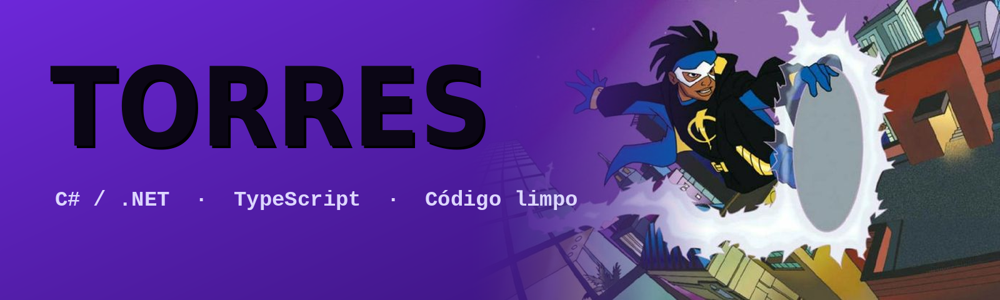

  

<h1 align="center">Fala, eu sou o Arthur Torres 👋</h1>

  <b>Back-end C# / .NET · APIs · Sistemas Web</b> 
  Transformando regras de negócio em código limpo, e ideias em sistemas que funcionam.

  
  
  

---

## 🟣 Sobre mim

Sou estudante de **Sistemas de Informação**, com foco em desenvolvimento **back-end C#/.NET**: construção de APIs e organização de regras de negócio.

Meu principal projeto é o **Gueto Barbearia**, um sistema de agendamento que une interface web e uma API em ASP.NET Core. Ele transforma um fluxo real, escolher serviço, data e horário, em código, validações e endpoints.

Também trabalho com **TypeScript, React, Node.js, JavaScript, SQL e PostgreSQL**, conectando o back-end a interfaces modernas.

📍 Volta Redonda, RJ · 🎓 Sistemas de Informação

---

## ⚡ Em foco

- 🔭 **Projeto:** Gueto Barbearia
- ⚙️ **Back-end:** C#, .NET, ASP.NET Core Minimal APIs, REST e JSON
- 🗄️ **Dados:** SQL e PostgreSQL
- 🎯 **Objetivo:** primeira oportunidade em desenvolvimento de software/back-end

---

## 🛠️ Tecnologias e ferramentas

**Linguagens e frameworks**

  

**Front-end**

  

**Banco de dados**

  

**Ferramentas**

  

---

## 🚀 Projeto em destaque

### [Gueto Barbearia](https://github.com/SEU-USUARIO/SEU-REPOSITORIO)

Sistema de agendamento para barbearia com front-end interativo e API REST em ASP.NET Core.

- **Front-end:** catálogo com serviços, manipulação do DOM, formulário e resumo do agendamento
- **API:** consulta de serviços e operações de criação, consulta, atualização e exclusão de agendamentos, com validações
- **Próximo passo:** persistência com SQL/PostgreSQL e integração do formulário com a API

---

## 📊 Atividade no GitHub

  
  

  

---

## 💬 Vamos conversar?

Aberto a conversas sobre back-end, APIs e oportunidades de estágio ou primeiro emprego em tecnologia.

  

